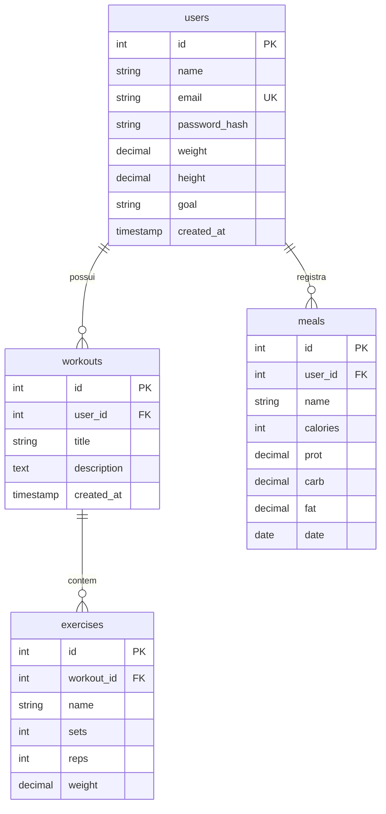

[README.md](https://github.com/user-attachments/files/33081555/README.md)
<div align="center">

# 💪 Fitness Manager

**Sistema web para gerenciamento de treinos, dieta e alunos.**


</div>

---

## 📖 Sobre

O **Fitness Manager** permite que cada usuário cadastre suas rotinas de treino (com séries, repetições e carga), registre refeições com calorias e macronutrientes e acompanhe tudo em um dashboard com resumo diário e semanal.

O projeto usa **JavaScript Vanilla** no frontend (sem frameworks nem build) e uma **API REST** em Node.js/Express com banco relacional MySQL.

## ✨ Funcionalidades

- **Autenticação**: cadastro e login com JWT; senhas protegidas com bcrypt
- **Perfil**: edição de peso, altura e objetivo, com cálculo automático de IMC
- **Treinos (CRUD)**: crie rotinas como *Treino A - Peito e Tríceps* e gerencie os exercícios de cada uma
- **Dieta (CRUD)**: registre refeições por dia, com calorias, proteínas, carboidratos e gorduras
- **Dashboard**: contagens, macros do dia, calorias dos últimos 7 dias e treinos recentes
- **Tema escuro/claro** com preferência salva no navegador
- **Interface responsiva**

## 🧰 Tecnologias

| Camada | Tecnologias |
|---|---|
| Frontend | HTML5 semântico, CSS3 (variáveis CSS), JavaScript ES6+ (módulos) |
| Backend | Node.js, Express.js |
| Banco de dados | MySQL 8 (`mysql2`) |
| Segurança | `jsonwebtoken`, `bcryptjs`, `cors` |

## 🗂️ Estrutura do projeto

```
fitness-manager/
├── backend/
│   ├── server.js                      # Entrada: Express, rotas e arquivos estáticos
│   └── src/
│       ├── config/db.js               # Pool de conexões MySQL
│       ├── middlewares/
│       │   └── authMiddleware.js      # Validação do JWT
│       ├── controllers/               # Regras de negócio
│       │   ├── authController.js
│       │   ├── workoutController.js
│       │   ├── mealController.js
│       │   └── dashboardController.js
│       ├── routes/                    # Definição dos endpoints
│       └── utils/                     # asyncHandler e httpError
├── database/
│   ├── schema.sql                     # Criação das tabelas (DDL)
│   └── seed.sql                       # Dados de teste (DML)
├── frontend/
│   ├── index.html                     # Login e cadastro
│   ├── dashboard.html                 # Painel do usuário
│   ├── css/style.css
│   └── js/                            # api, auth, dashboard, dom, theme
├── .env.example
└── package.json
```

## 🚀 Como executar

### Pré-requisitos

- [Node.js](https://nodejs.org/) 18 ou superior
- [MySQL](https://www.mysql.com/) 8 ou superior

### Passo a passo

```bash
# 1. Clone o repositório
git clone https://github.com/SEU-USUARIO/fitness-manager.git
cd fitness-manager

# 2. Instale as dependências
npm install

# 3. Crie o banco e as tabelas
mysql -u root -p < database/schema.sql

# 4. (Opcional) Carregue dados de teste
mysql -u root -p < database/seed.sql

# 5. Configure as variáveis de ambiente
cp .env.example .env
# edite o .env com a senha do MySQL e um JWT_SECRET próprio

# 6. Inicie o servidor
npm start
```

Acesse **http://localhost:3000**.

Com o `seed.sql` carregado, use o login de teste: `aluno@teste.com` / `123456`.

> Para desenvolvimento com recarga automática: `npm run dev`

### Variáveis de ambiente

| Variável | Descrição | Padrão |
|---|---|---|
| `PORT` | Porta do servidor | `3000` |
| `DB_HOST` | Host do MySQL | `localhost` |
| `DB_PORT` | Porta do MySQL | `3306` |
| `DB_USER` | Usuário do banco | `root` |
| `DB_PASSWORD` | Senha do banco | — |
| `DB_NAME` | Nome do banco | `fitness_manager` |
| `JWT_SECRET` | Chave de assinatura do token (**obrigatória**) | — |
| `JWT_EXPIRES_IN` | Validade do token | `7d` |

## 🗄️ Modelo de dados



## 🔌 API

Todas as rotas, exceto `register` e `login`, exigem o header:

```
Authorization: Bearer <token>
```

| Método | Rota | Descrição |
|---|---|---|
| `POST` | `/api/auth/register` | Cadastra usuário e retorna o token |
| `POST` | `/api/auth/login` | Autentica e retorna o token |
| `GET` `PUT` | `/api/auth/profile` | Consulta e atualiza o perfil |
| `GET` `POST` | `/api/workouts` | Lista e cria treinos |
| `GET` `PUT` `DELETE` | `/api/workouts/:id` | Consulta, edita e exclui um treino |
| `POST` | `/api/workouts/:id/exercises` | Adiciona exercício ao treino |
| `PUT` `DELETE` | `/api/workouts/:id/exercises/:exerciseId` | Edita e remove exercício |
| `GET` `POST` | `/api/meals?date=AAAA-MM-DD` | Lista (filtro por dia) e registra refeições |
| `PUT` `DELETE` | `/api/meals/:id` | Edita e exclui refeição |
| `GET` | `/api/dashboard?date=AAAA-MM-DD` | Resumo do usuário |

### Exemplo

```bash
# Login
curl -X POST http://localhost:3000/api/auth/login \
  -H "Content-Type: application/json" \
  -d '{"email":"aluno@teste.com","password":"123456"}'

# Criar treino (substitua <token>)
curl -X POST http://localhost:3000/api/workouts \
  -H "Authorization: Bearer <token>" \
  -H "Content-Type: application/json" \
  -d '{"title":"Treino C - Pernas","exercises":[{"name":"Agachamento","sets":4,"reps":8,"weight":80}]}'
```

## 🔒 Segurança

- Senhas armazenadas apenas como hash (bcrypt, 10 rounds)
- Todas as queries são parametrizadas, o que previne SQL Injection
- Cada recurso é filtrado pelo `user_id` do token, então um usuário não acessa dados de outro
- O frontend monta o DOM sem `innerHTML`, o que previne XSS
- Mensagem de erro genérica no login, para não revelar quais e-mails existem

> Antes de colocar em produção: use um `JWT_SECRET` forte, habilite HTTPS e restrinja o CORS ao domínio do seu frontend.

## 🛣️ Próximos passos

- [ ] Perfil de "personal" para gerenciar vários alunos
- [ ] Histórico de evolução de peso e cargas
- [ ] Suporte a PostgreSQL
- [ ] Testes automatizados
- [ ] Docker Compose (app + banco)

## 📄 Licença

Distribuído sob a licença MIT.
